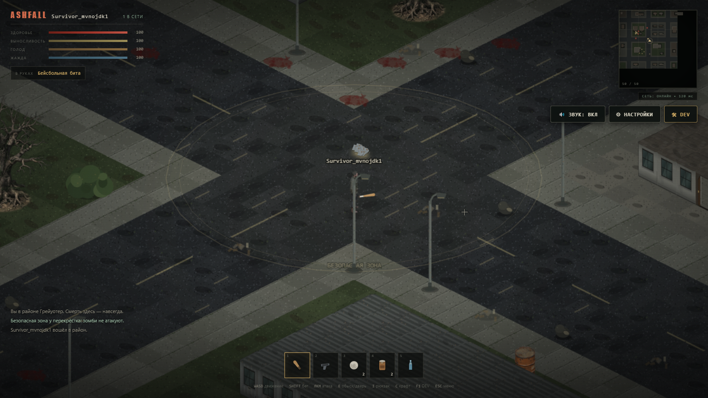
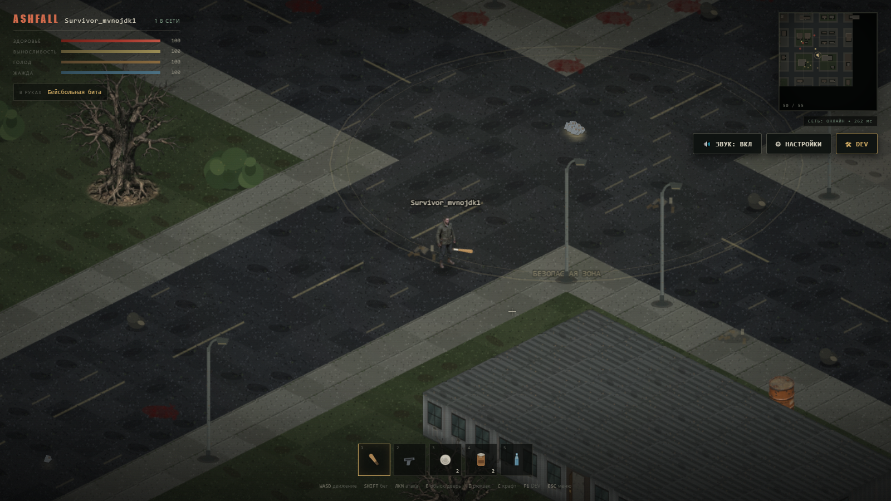

# ASHFALL: Greywater District

Браузерный изометрический survival-PvP в зомби-апокалипсисе. Постоянный городской мир, авторитетный сервер, сохранение персонажей и мира в PostgreSQL. Оригинальный сеттинг и ассеты, вдохновлённые плотностью деталей и атмосферой Project Zomboid, но без использования его ресурсов, карт, кода и названий.

> **Статус: рабочий прототип, не готовая игра.** Вертикальный срез играбелен, но визуальное качество и часть систем ещё не доведены. Честный список того, что проверено и что сломано — в [`docs/STATUS.md`](docs/STATUS.md). Инструкции для продолжения работы другой моделью/разработчиком — в [`docs/HANDOFF_GEMINI.md`](docs/HANDOFF_GEMINI.md).




## Что уже реализовано

- **Клиент:** Phaser 3.90 + TypeScript + Vite, изометрическая камера, интерполяция, клиентское предсказание движения, HUD на HTML/CSS, миникарта, инвентарь, чат, звук (процедурный WebAudio), скрытие крыш при входе в здание.
- **Графика:** собственный процедурный пайплайн (тайлы, стены, крыши, машины, деревья, мебель, персонажи, иконки), единый масштаб и освещение; атласы для производительности. Key art меню сгенерирован через Cloudflare FLUX и лежит в `client/public/assets/keyart.png`.
- **Сервер:** Node.js + `ws`, фиксированный тик 20 Гц, снимки 12 Гц, серверная проверка перемещения/боя/инвентаря, AOI, выдача чанков по запросу, LOD зомби, безопасная зона на спавне.
- **Мир:** 128×128 тайлов, 16 чанков по 32×32, детерминированная генерация улиц/кварталов/зданий/интерьеров/машин/деревьев/контейнеров, двери, разрушаемые пропсы, 127 зомби (ходоки/бегуны/громилы).
- **Геймплей:** здоровье, выносливость, голод/жажда, ближний бой и пистолет, PvP, полный дроп лута после смерти, авто-респавн, контейнеры и перенос предметов, подбор/выброс, стартовый набор.
- **Данные:** PostgreSQL 16, миграции, аккаунты (scrypt), сессии (хеш токена), персонажи, предметы, контейнеры, двери, состояние пропсов, зомби, события, чанки.
- **Инфраструктура:** Docker Compose (Postgres + server + nginx/client), CI (typecheck/test/build), скрипты разработки, smoke/visual-скрипт Playwright.

## Развёртывание на VPS в одну команду

Для автоматической установки на чистый VPS с **Ubuntu 22.04 / 24.04 LTS** выполните:

```bash
curl -fsSL https://raw.githubusercontent.com/z-horror/ashfall/main/deploy/install.sh -o install.sh && sudo bash install.sh
```

Установщик автоматически:
- Проверит порты и выделит swap при необходимости;
- Установит Docker и Compose;
- Настроит безопасные пароли в `.env` и HTTPS-проксирование через Caddy (Let's Encrypt);
- Накатит миграции базы данных и создаст первый инвайт-код;
- Добавит утилиту управления `ashfall` в `/usr/local/bin` и настроит ежедневный бэкап.

Подробная документация: [**Руководство по развёртыванию и администрированию**](docs/DEPLOYMENT.md).

## Локальный запуск (Docker)

```bash
cp .env.example .env
docker compose up -d --build
# Клиент и игра:     http://localhost
# Панель админа:    http://localhost/admin
# Проверка сервера: http://localhost/api/health
```

Первый запуск применяет миграции автоматически (`MIGRATE_ON_START=true`) и генерирует мир по `WORLD_SEED`.

Остановить:

```bash
docker compose down
```

Полностью сбросить мир (удалит персонажей, лут, зомби и двери):

```bash
docker compose down -v
```

> Docker-путь добавлен и описан; перед прод-использованием проверьте сборку на своей машине. Локальный dev-путь ниже проверен.

## Локальная разработка

Требования: Node.js 22+, Docker, npm 10+.

```bash
cp .env.example .env
npm install
docker compose up -d db
npm run migrate
npm run dev
# клиент: http://localhost:5173
# API/WS: http://localhost:3000
```

`npm run dev` поднимает PostgreSQL (если не запущен), применяет миграции, запускает сервер и Vite.

Полезные команды:

```bash
npm run typecheck      # shared + server + client
npm test               # 10 unit-тестов (RLE, физика, мир, инвентарь)
npm run build          # production build клиента и сервера
npm run db:up / db:down
npm run test:visual    # Playwright: скриншоты мира/инвентаря/боя
```

Для visual-теста нужен запущенный клиент и сервер, а также Chromium из Playwright. Путь можно задать через `CHROMIUM_PATH`.

## Управление

| Клавиша | Действие |
|---|---|
| `W A S D` / стрелки | движение |
| `Shift` | бег (тратит выносливость) |
| Мышь | прицеливание |
| ЛКМ | атака / выстрел |
| `E` | дверь, контейнер, подбор предмета |
| `I` | инвентарь и снаряжение |
| `1–5` | быстрые слоты |
| `T` | чат |
| `Esc` | закрыть окно/чат |
| `Enter` | отправить сообщение |

Смерть: инвентарь выпадает на месте смерти, персонаж возрождается на перекрёстке через 9 секунд. У перекрёстка действует безопасная зона: зомби не атакуют и выталкиваются из неё.

## Архитектура одним взглядом

```text
client (Phaser 3, TS, Vite)
  │ WebSocket JSON, protocol v1
  ▼
server (Node, ws, authoritative sim 20 Hz)
  │ pg (transactions for items/death/loot)
  ▼
PostgreSQL 16
```

- Клиент отправляет только ввод и команды; сервер считает движение, коллизии, бой, урон, смерть, лут и инвентарь.
- Мир статичен и детерминирован от seed; динамика (двери, пропсы, контейнеры, зомби, лут) хранится в БД.
- Сервер отправляет клиенту только ближайшие чанки (3×3) и сущности в AOI (28 тайлов). Зомби симулируются только рядом с игроками.
- Клиент реконструирует коллизии из чанков и предсказывает своё движение, сервер корректирует расхождения.
- Критичные операции с предметами выполняются в транзакциях с `FOR UPDATE`; смерть и лут — атомарно.

Подробно: [`docs/ARCHITECTURE.md`](docs/ARCHITECTURE.md), [`docs/PROTOCOL.md`](docs/PROTOCOL.md), [`docs/DECISIONS.md`](docs/DECISIONS.md).

## Структура проекта

```text
ashfall/
├── client/               # Phaser 3 + Vite
│   ├── src/
│   │   ├── art/          # процедурные текстуры, атласы, персонажи
│   │   ├── game/         # GameScene, iso-математика
│   │   ├── net/          # WebSocket, HTTP auth
│   │   ├── ui/           # HUD, инвентарь, миникарта
│   │   ├── world/        # чанки, клиентский мир, entity view
│   │   ├── audio.ts
│   │   ├── main.ts
│   │   └── styles.css
│   ├── public/assets/    # keyart (Cloudflare FLUX)
│   ├── Dockerfile
│   └── nginx.conf
├── server/
│   ├── src/
│   │   ├── game/         # world gen, simulation
│   │   ├── net/          # WS gateway, rate limit, auth handshake
│   │   ├── persistence/  # pg pool, repository, migrations runner
│   │   ├── auth.ts       # scrypt, sessions, HTTP auth
│   │   ├── config.ts
│   │   └── index.ts
│   ├── test/
│   └── Dockerfile
├── shared/               # протокол, типы, константы, физика, RLE
├── database/migrations/  # SQL
├── docs/                 # архитектура, статус, handoff, тесты
├── tools/                # Playwright visual test / atlas exporter
├── scripts/dev.sh
├── docker-compose.yml
└── .env.example
```

## Переменные окружения

Смотрите [`.env.example`](.env.example). Ключевые:

- `DATABASE_URL` — строка подключения PostgreSQL.
- `WORLD_SEED` — детерминированный seed. **Менять только вместе с очисткой БД**; сервер откажется стартовать при несовпадении с `world_meta`.
- `TICK_HZ`, `SNAPSHOT_HZ`, `AOI_RADIUS`, `CHUNK_RADIUS` — производительность/сеть.
- `SESSION_TTL_HOURS`, `MAX_MESSAGE_BYTES`, `MAX_MESSAGES_PER_SEC` — безопасность.
- `VITE_API_BASE`, `VITE_WS_URL` — только для клиентской сборки, если API/WS на другом origin.

## Проверки, которые уже проходили

- `npm run typecheck` — без ошибок (shared/server/client).
- `npm test` — 10/10 unit-тестов.
- `npm run build` — клиент и сервер собираются.
- Ручной браузерный тест: guest-вход, загрузка 3×3 чанков, движение, HUD, инвентарь, безопасный спавн, стартовый набор, зомби в мире.
- Скриншоты: [`docs/screenshots`](docs/screenshots). На них виден известный артефакт — тёмные швы между тайлами земли (см. STATUS, `VIS-01`).

## Известные проблемы (кратко)

1. **VIS-01:** тёмная сетка на земле из-за AO-градиента на каждом тайле; нужно убрать/ослабить швы.
2. **PERF-01:** в software-WebGL (headless) генерация ассетов и загрузка чанков медленные (~13 с арт + ~1–2 с на чанк). На реальном GPU не измерено; нужно профилировать.
3. **VIS-02:** город выглядит разреженным у спавна; здания визуально одноэтажные, крыши плоские; нужен вертикальный масштаб и плотность.
4. **TEST-01:** нет автоматического E2E на двух клиентов, PvP, перенос лута и рестарт сервера.
5. **GAME-01:** нет перезарядки как отдельного действия, баррикад, шума/привлечения зомби от выстрелов реализовано частично.
6. **SEC-01:** нет TLS/проверки Origin в dev, нет полноценной защиты от читов; см. `docs/SECURITY.md`.

Полный список с приоритетами — [`docs/STATUS.md`](docs/STATUS.md) и [`docs/ROADMAP.md`](docs/ROADMAP.md).

## Передача работы

Проект подготовлен для продолжения другой моделью (Gemini/Claude Opus в Antigravity) или разработчиком:

- [`docs/HANDOFF_GEMINI.md`](docs/HANDOFF_GEMINI.md) — пошаговый план, задачи P0/P1/P2, критерии приёмки, подводные камни.
- [`AGENTS.md`](AGENTS.md) — правила для локального агента в репозитории.
- [`docs/TESTING.md`](docs/TESTING.md) — как проверять.
- [`docs/ART_PIPELINE.md`](docs/ART_PIPELINE.md) — как устроена графика и как её улучшать.
- [`docs/STATUS.md`](docs/STATUS.md) — что реально работает.

## Безопасность и честные ограничения

Сервер авторитетен и валидирует команды, но это **не** защищённая от всех читов игра. Нет TLS в dev, нет аппаратной аттестации клиента, возможны DoS-векторы, а PvP и полный лут — жёсткие правила прототипа. Не используйте реальные пароли. Подробности и известные ограничения: [`docs/SECURITY.md`](docs/SECURITY.md).

## Лицензия

Private prototype. Все процедурные ассеты созданы в этом проекте. Key art сгенерирован Cloudflare FLUX специально для проекта. Сторонние библиотеки — по их лицензиям (Phaser MIT, PostgreSQL License, и т.д.).
