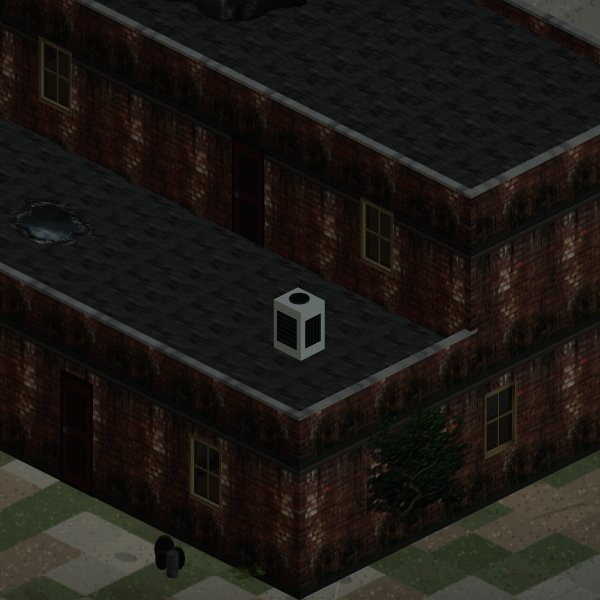
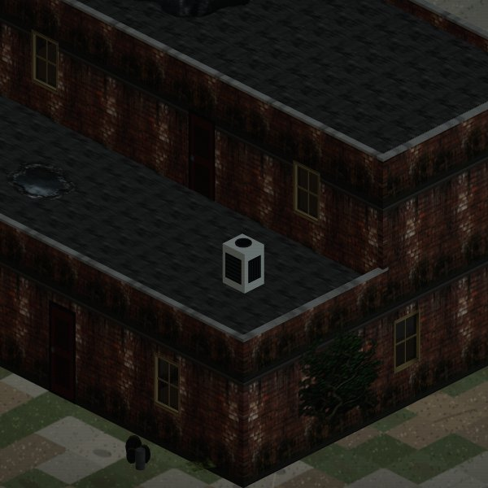
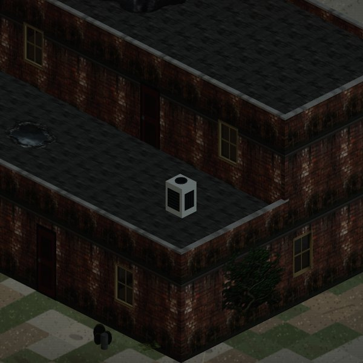
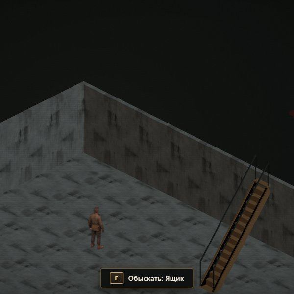
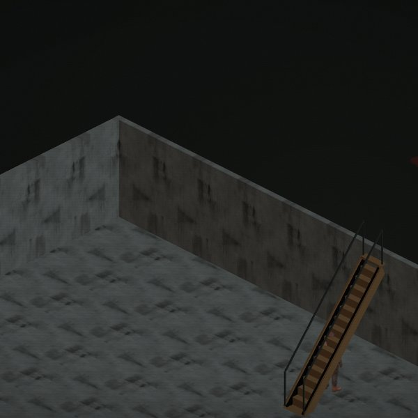
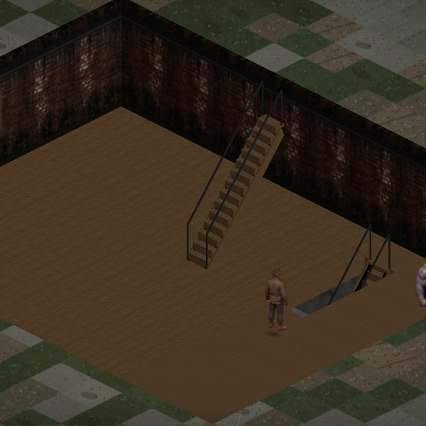
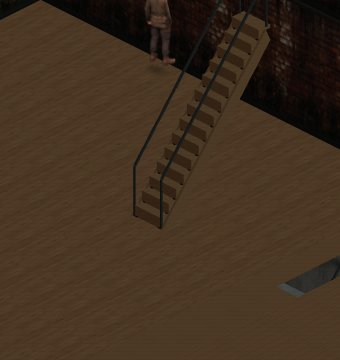
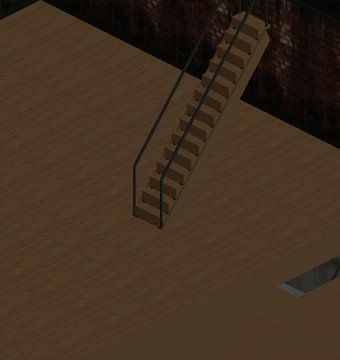
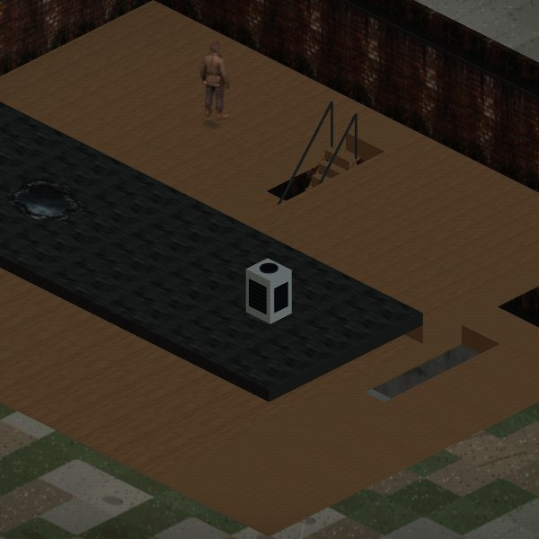
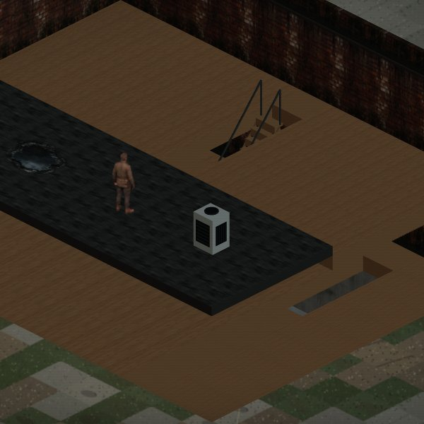

# Визуальная приёмка M1 (P0-стабилизация 3D-дома)

Все снимки получены локальным Playwright-аудитом (`tools/m1-visual-audit.mjs` и `tools/crop_m1_audit.mjs`) на реальном GPU/Chromium по адресу `http://127.0.0.1:5173/?render3d=1&buildingTest=1`.

---

## 1. Четыре ракурса вокруг дома

| Юг (South) | Восток (East) |
|---|---|
|  |  |

| Север (North) | Запад (West) |
|---|---|
|  |  |

**Результат:** Серый бассейн и выступы цоколя/подвала снизу устранены благодаря `margin = 14.0m` у `groundOccluder` и скрытию подвального уровня снаружи.

---

## 2. Подвал и лестницы

| Подвал (floor = -1) | Лестница подвала (снизу) | Кухня и лестница вниз (floor = 0) |
|---|---|---|
|  |  |  |

**Результат:**
- Подвал: чистый бетонный пол и стены, потолочные балки и цоколь над головой скрыты.
- Лестница видна на этажах -1 и 0, имеет тетивы, ступени и ограждения.
- Пол кухни: z-fighting полностью устранён смещением окклюдера на `z = -0.005`.

---

## 3. Персонаж у стены и контактная тень

| У северной стены | У западной стены |
|---|---|
|  |  |

**Результат:**
- Персонаж не проваливается в 3D-стены благодаря `depth bias` и `CHARACTER_CAMERA_OFFSET`.
- Контактная тень плотно прилегает к подошвам без зазора.

---

## 4. Мансарда, терраса и декали

| Мансарда (floor = 1) | Терраса, AC и заплатки |
|---|---|
|  |  |

**Результат:**
- Декали (плющ, лужа, заплатки рубероида, сколотый кирпич) берутся отдельными кадрами атласа.
- Внешний декор (ящики, бочки, поддоны) автоматически скрывается внутри дома.
