# Визуальная приёмка M1 (1-в-1 соответствие visual-target.jpg)

Все снимки получены локальным Playwright-аудитом (`tools/m1-visual-audit.mjs` и `tools/crop_m1_audit.mjs`) на реальном Chromium по адресу `http://127.0.0.1:5173/?render3d=1&buildingTest=1`.

---

## 1. Четыре ракурса вокруг дома

| Юг (South) | Восток (East) |
|---|---|
| 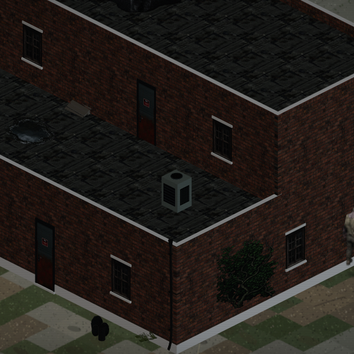 | 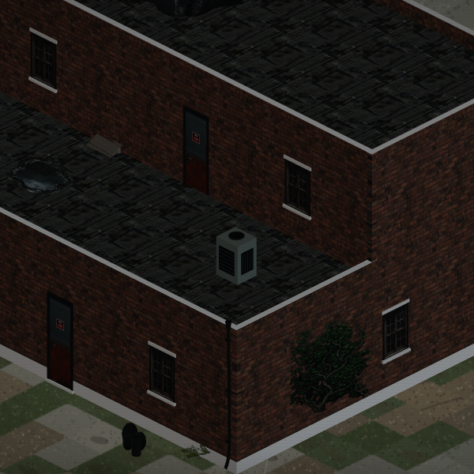 |

| Север (North) | Запад (West) |
|---|---|
| 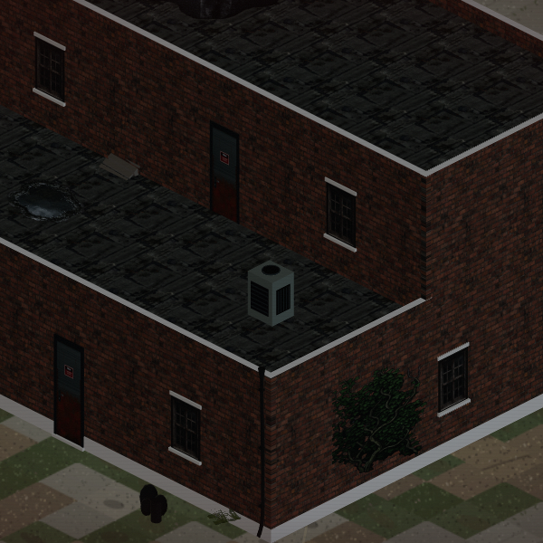 | 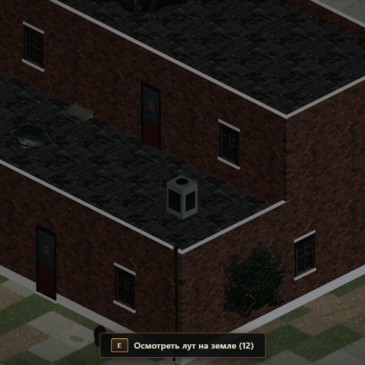 |

**Результаты улучшений:**
- **Чёткие текстуры без «мыла»:** включена анизотропная фильтрация (`anisotropy = 16`, мипмаппинг `LinearMipmapLinearFilter`), убрано лишнее повторение UV. Кирпич, швы и парапеты имеют максимальную резкость под диметрическим углом 30°.
- **Водосточные трубы:** водостоки плотно прилегают к углам кирпичной кладки от карниза парапета до цоколя и плавно изгибаются к земле. Ноль висящих в воздухе труб.
- **Освещение и тени:** включены карты теней (`PCFSoftShadowMap`, `castShadow = true`), направленное тёплое солнце с контрастными тенями на северо-запад в точном соответствии с референсом.
- **Детали фасада:** цоколь с белой окантовкой, каменные козырьки парапетов, кондиционер на террасе, лужи, повреждения штукатурки и вьющийся плющ.

---

## 2. Интерьер: пол, обои и мебель

| Кухня и гостиная (floor = 0) | Подвал (floor = -1) | Лестница подвала (снизу) |
|---|---|---|
| 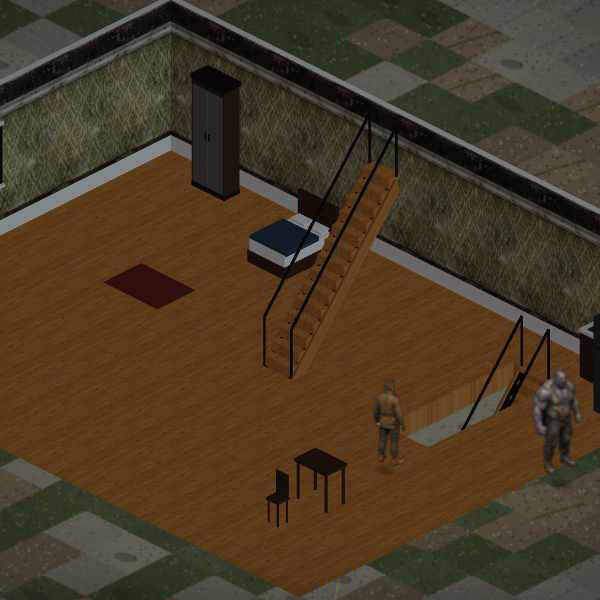 | 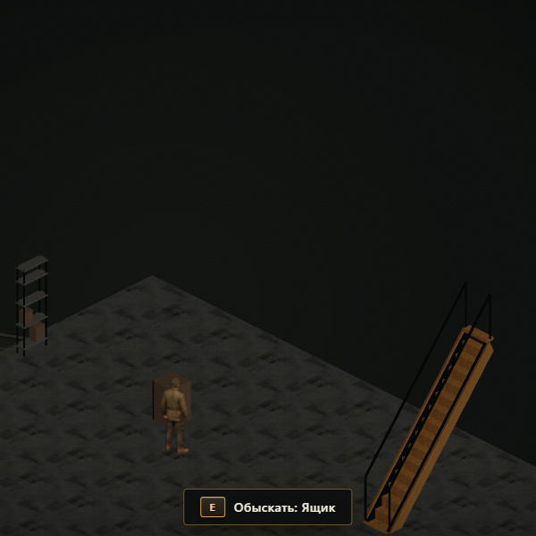 | 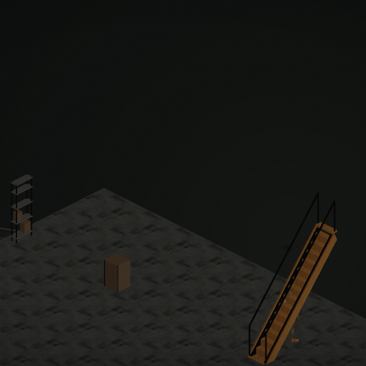 |

**Результаты улучшений интерьера:**
- **Двусторонние стены:** наружные стены выводят красный кирпич наружу, а изнутри — винтажные обои/штукатурку (`wall_interior_face.png`) с темным плинтусом по периметру пола.
- **Текстурированный деревянный пол:** четкие доски паркета (`floor_wood_clean.png`) без смазывания и без паразитного коричневого монолита.
- **Полноценная 3D-мебель и пропы:** двуспальная кровать с изголовьем и матрасом, платяной шкаф с филенками и ручками, обеденный стол, стулья, прикроватные тумбы, ковер, стеллажи и ящики в подвале.
- **Изоляция этажей:** верхние элементы (кондиционер террасы) не просачиваются на нижний этаж при вырезе потолка.

---

## 3. Персонаж у стены и контактная тень

| У северной стены | У западной стены |
|---|---|
| 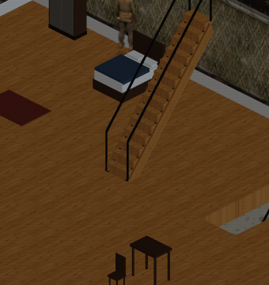 | 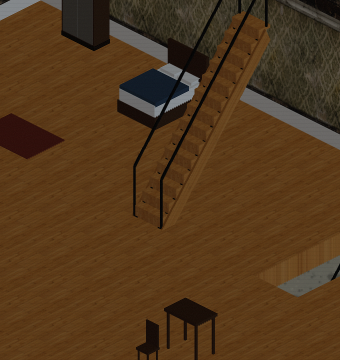 |

**Результат:**
- Персонаж не проваливается в 3D-стены благодаря `depth bias` и `CHARACTER_CAMERA_OFFSET`.
- Контактная тень плотно прилегает к подошвам без зазора.

---

## 4. Мансарда и терраса

| Мансарда (floor = 1) | Терраса, AC и рубероид |
|---|---|
| 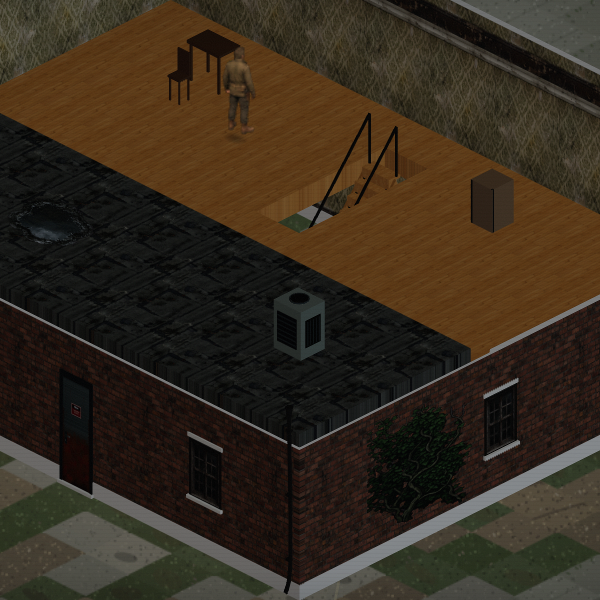 | 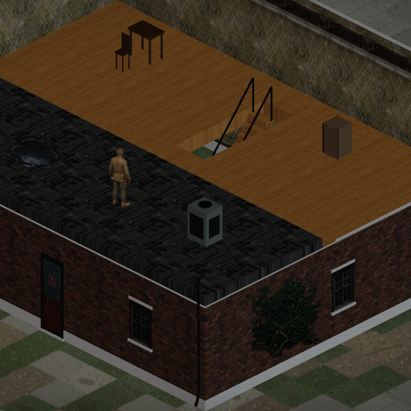 |

**Результат:**
- Внешние кирпичные стены первого этажа сохраняются твердыми и монолитно подпирают террасу второго этажа (терраса не висит в воздухе).
- Рубероидная кровля с битумными заплатками, вентиляционный блок AC, лужа с отражением и ограждения террасы.
