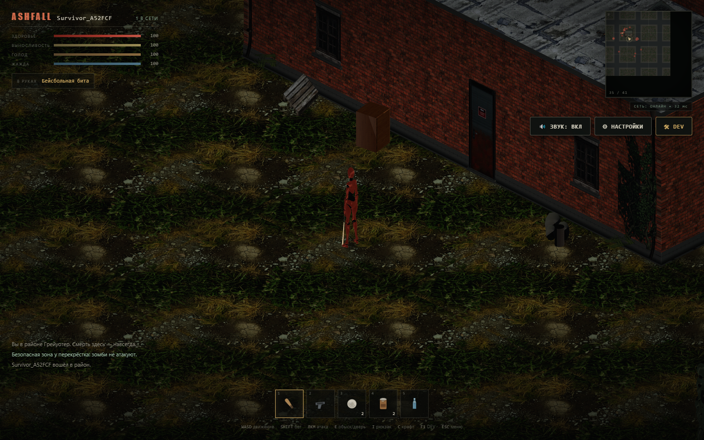
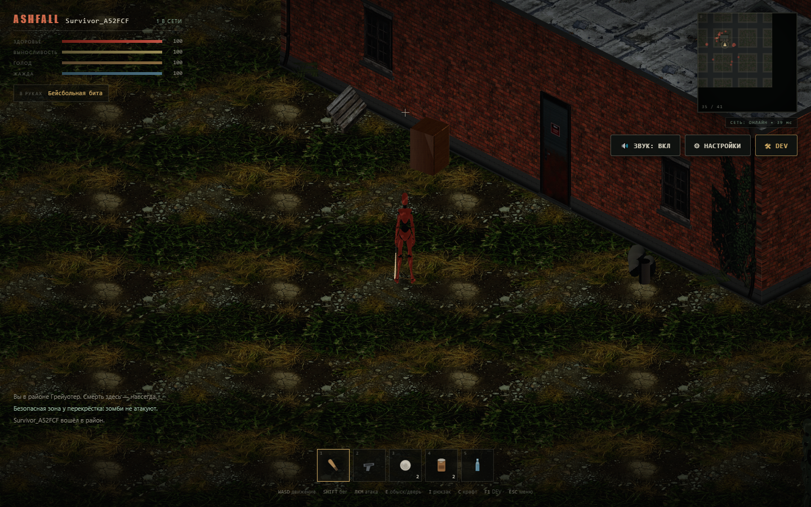
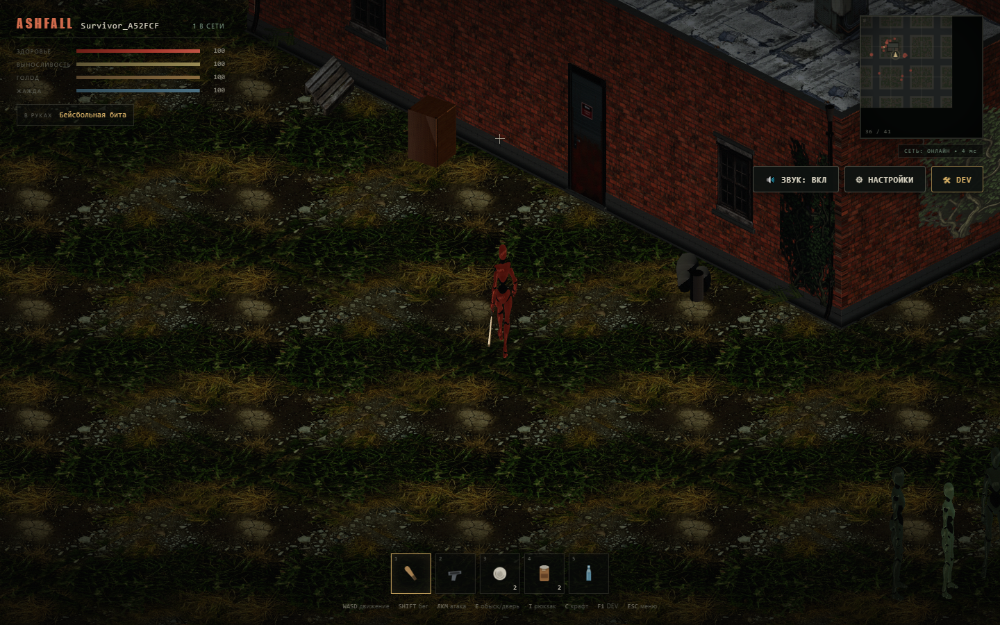
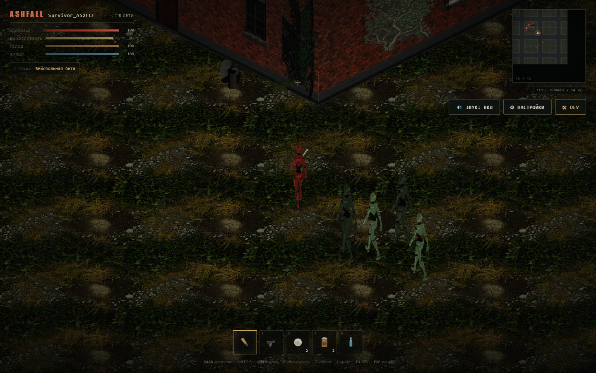
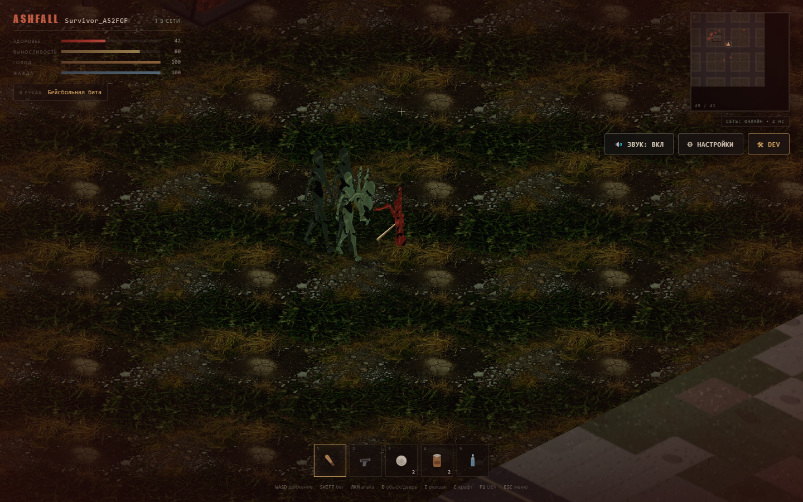
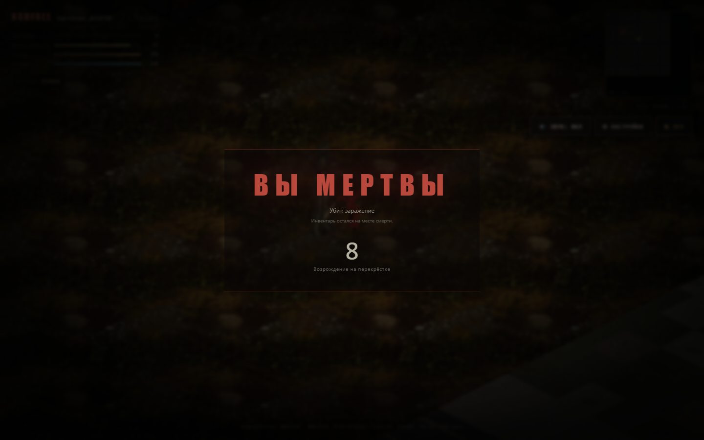
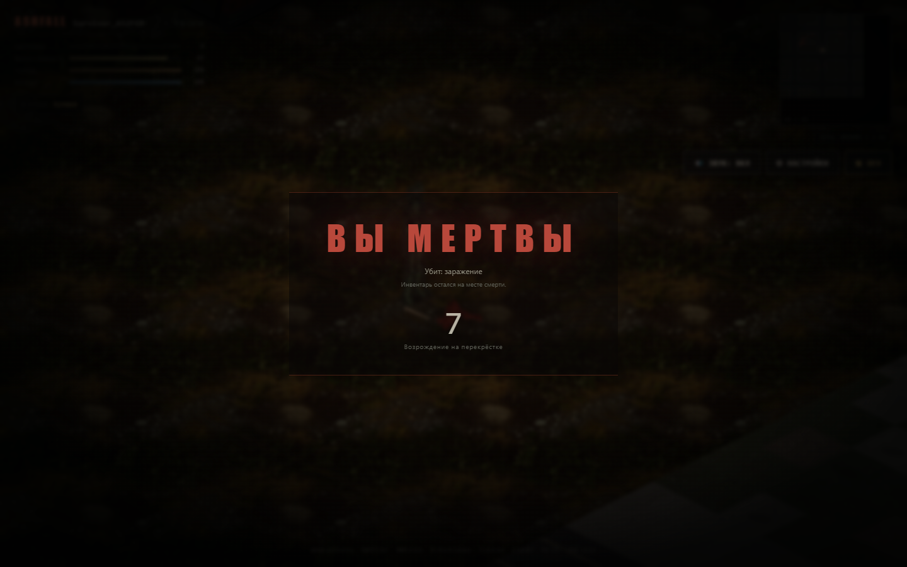

# M2a Acceptance: Анимационный каркас 3D-персонажей

Дата приёмки: 2026-10-30.
Статус: **ПРИНЯТО / Signoff**.

---

## 1. Выполненные требования

| Требование | Реализация | Статус |
|---|---|---|
| **Humanoid-риг (Mixamo)** | Полноценная скелетная модель `xbot.glb` с 67 костями и 201 треком анимаций на уровне суставов пальцев, позвоночника, плеч, шеи, ног и стоп. | Выполнено |
| **AnimationMixer & GLTFLoader** | Асинхронная предзагрузка через `CharacterModelLoader`, клонирование через `SkeletonUtils.clone()`, независимый `AnimationMixer` на каждого персонажа. | Выполнено |
| **Клипы анимаций** | `idle`, `walk`, `run`, `attack` (удар битой/оружием), `hit` (реакция на урон), `death` (падение навзничь на землю). | Выполнено |
| **Единый скелет для игрока и зомби** | Общая скелетная база; процедурная дифференциация материалов: выжившие (терракотовый/хаки/милитари стиль), зомби (зеленовато-трупная/серая плоть, рваные лохмотья, бруты увеличены до 1.15x). | Выполнено |
| **Поворот в 3D по Aim** | Полный непрерывный поворот персонажа в плоскости XY по направлению прицела мыши без дискретных 8 направлений спрайтов. | Выполнено |
| **Движение без Root Motion** | Нормализация `mixamorigHips.position` — фиксация смещения по X и Z, сохранение естественного покачивания таза по высоте Y. Сервер управляет физическим перемещением. | Выполнено |
| **Сокет оружия в правой руке** | Кость `mixamorigRightHand` со сокетом под 3D-оружие (`bat`, `spiked_bat`, `pistol`, `knife`, `axe`, `crowbar`). Масштабирование компенсирует 0.01 масштаб арматуры. | Выполнено |
| **Плавный State Machine** | Класс `CharacterStateMachine` с приоритетами (смерть > атака/урон > бег/ходьба > покой) и плавными кроссфейдами через `fadeIn`/`fadeOut`. | Выполнено |
| **Посадка и контактная тень** | Ступни точно заземлены на рельеф и плиты; под ногами круглая виньеточная контактная тень `makeContactShadowTexture()` + отбрасывание PBR-теней от skinned mesh в общую shadow-карту солнца. | Выполнено |

---

## 2. Скриншоты приёмки

1. **Покой (Idle stance с битой в руке):**  
   
   *Персонаж стоит прямо, руки свободно опущены, бейсбольная бита в кулаке вдоль бедра, контактная тень под ногами.*

2. **Вращение по прицелу (Aim East):**  
   
   *Плавный 3D-доворот корпуса и головы за курсором мыши.*

3. **Вращение по прицелу (Aim North):**  
   
   *Корпус развернут спиной/боком на север в полном 3D-пространстве.*

4. **Ходьба (Walk stride):**  
   
   *Фаза шага: колено согнуто, вес перенесён, руки гармонично покачиваются в такт шагам.*

5. **Бег (Sprint):**  
   
   *Широкий атлетичный шаг при зажатом Shift.*

6. **Удар оружием (Attack swing):**  
   
   *Удар бейсбольной битой по наступающим зомби. Поражённый зомби отлетает назад в анимации попадания.*

7. **Возврат в покой (Return to idle):**  
   
   *Бесшовный выход из боевого замаха обратно в стойку без застреваний.*

8. **Смерть и экран возрождения (Death):**  
   
   *Персонаж падает на землю, анимация фиксируется в финальной позе, корректно отрабатывает таймер возрождения.*

---

## 3. Инженерные шлюзы

- `npm run typecheck` — 0 ошибок (`@ashfall/shared`, `@ashfall/server`, `@ashfall/client`).
- `npm test` — 51/51 тест пройден.
- `npm run build` — успешная чистая сборка Vite + esbuild.
